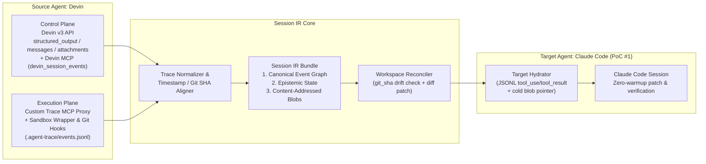

# Session IR

**Treat agent session traces as portable, composable brain slices — not disposable chat logs.**

Most multi-agent governance frameworks model agents like human organizations (roles, org charts, group chats, separate `AGENT.md` prompts). Humans need division of labor because human expertise is narrow and human memory is non-transferable. Coding agents are the opposite: frontier LLMs are generalists, and their working memory is serializable state.

**Session IR** defines a model-agnostic intermediate representation (IR), dual-channel trace capture adapters, and target hydrators so heterogeneous coding agents (**Devin**, **Claude Code**, **Codex**, etc.) can hand off long-horizon engineering work mid-flight without losing verified context or inducing cross-model prompt confusion.

---

## Architecture Overview



---

## Core Design: Why Raw Chat Logs Fail

Dumping one agent's raw transcript into another agent breaks immediately:
1. **System prompt & tool-schema collision**: Model B sees synthetic tool calls/results that don't match its own tool declarations.
2. **Private CoT poisoning**: Model-specific reasoning styles and internal scratchpads confuse the receiving model rather than helping it.
3. **Workspace drift**: File edits or branch updates since capture invalidate stale observations in context.
4. **Context bloat**: Full test logs and stack traces blow up the receiving context window.

### Three-Layer Session IR

Session IR separates **what happened**, **what was learned**, and **how the target agent consumes it**:

| Layer | Responsibility | Key Invariants |
| --- | --- | --- |
| **1. Canonical Action & Observation Layer** | Typed DAG of normalized primitives: `fs.read`, `fs.diff`, `shell.exec`, `search.query`, `web.fetch`, `vcs.checkpoint` | Every node binds `cwd`, `git_sha`, `exit_code`, and `timestamp`. Large outputs live in content-addressed cold storage (`sha256` blob refs). |
| **2. Epistemic State Layer** | Model-agnostic distilled knowledge stripped of private CoT | Three structured sets only: **Verified Facts** (pinned to `observation_id` evidence), **Ruled-out Hypotheses** (prevents dead-end retries), and **Open Constraints**. |
| **3. Target Hydrator Layer** | Compiles Session IR into a target agent's native session format | Runs **Workspace State Reconciliation** before injection (diffs exported `git_sha` against current HEAD/worktree) and emits schema-valid native history (e.g., Claude Code JSONL). |

---

## Capturing Traces from Devin (Without Private APIs)

Devin does not expose raw internal step-by-step CoT or every low-level internal tool stdout via a single public switch. Rather than relying on brittle frontend scraping, Session IR uses a **dual-channel capture pipeline** built purely on official mechanisms and sandbox instrumentation:

1. **Control Plane (Semantic & Lifecycle Skeleton)**
   - Launch sessions via `POST /v3/organizations/{org_id}/sessions` with `structured_output_schema` (Draft 7 JSON Schema, `< 64 KB`, `structured_output_required: true`) so Devin maintains the **Epistemic State** live as validated JSON.
   - Pull chronological session messages (`GET /v3/organizations/{org_id}/sessions/{devin_id}/messages`), attachments (`GET .../attachments`), PR links, and `parent_session_id` / `child_session_ids` topology (plus `devin_session_events` via official Devin MCP).
2. **Execution Plane (Fine-Grained Action & Evidence Capture)**
   - **Custom Trace MCP Proxy**: Attach a lightweight MCP server (Customize > MCPs or `.devin/mcp_config.local.json`) to record structured args, timestamps, and result hashes for external queries/tools.
   - **Sandbox Instrumentation**: Via Skill instructions + lightweight repo-level shell/git wrappers, log key command executions (`cmd`, `exit_code`, `git_sha`, blob hash) to `.agent-trace/events.jsonl` and export as a session attachment or orphan trace branch on handoff.
3. **Merge & Align**
   - The normalizer joins Control Plane `structured_output` + `messages` with Execution Plane `events.jsonl` on `(timestamp, git_sha)` to produce a self-contained Session IR bundle.

---

## PoC #1: Devin → Claude Code Handoff (Runnable Prototype)

**First Concrete Test Case (`fixtures/poc_case_01_rate_limiter/`):**
- **Bug**: Multi-file `TokenBucket` freeze after a 5-minute NTP backward clock jump (`src/limiter/bucket.py:64` + `src/limiter/store/memory.py:28`), while `RedisStore` remains unaffected.
- **Devin Phase**: Reproduces the failing test (`1 failed, 47 passed`, 18.4 KB verbose debug trace stored in content-addressed cold blob), isolates 3 verified facts (`F1`–`F3`), and rules out 2 dead-end hypotheses (`H1` Redis Lua TTL race, `H2` float precision).
- **Pipeline Output (verified locally)**:
  - Aligns Devin v3 `structured_output` + `messages` with sandbox `.agent-trace/events.jsonl` into `Session IR 0.1.0` (`sir_deaba8d7700d`).
  - Reconciles `git_sha` drift (if `src/limiter/bucket.py` changes post-export, `F1` is auto-tagged `[STALE]` while `F2`/`F3` stay `[FRESH]`).
  - Hydrates into 8 schema-valid Claude Code JSONL records with strict 1:1 `tool_use`/`tool_result` pairing, reducing hot context from **19,521 B → 4,463 B (77.1% reduction)** via cold blob pointers.

### Quickstart (Zero External Dependencies)

```bash
# Run end-to-end tests (alignment, git_sha drift reconciliation, Claude Code JSONL hydration)
pytest -v

# Run CLI pipeline on PoC Case #1
PYTHONPATH=src python3 -m session_ir.cli fixtures/poc_case_01_rate_limiter --out-dir out
```

---

## 48-Hour Live Devin Milestone Plan ($50 Credit Budget)

| Window | Milestone | Concrete Deliverable |
| --- | --- | --- |
| **H0 – H12** | Live Devin v3 capture | Run `DevinV3Client` against 3 real open-source multi-file bug issues with `devin-epistemic-output.schema.json` + sandbox `.agent-trace` sidecar; commit real anonymized traces under `fixtures/live_devin/`. |
| **H12 – H30** | End-to-end Devin → Claude Code handoff | Feed exported Session IR bundles into local Claude Code sessions via `claude_hydrator.py` to generate & verify actual PR patches. |
| **H30 – H48** | 3-way A/B benchmark report | Publish measured metrics (Cold Claude Code vs. Prose Handoff vs. Session IR Handoff): redundant tool calls, tokens to first passing test, and Pass@1. |

---

## Repository Structure

```text
.
├── README.md                                  # Overview, PoC #1 quickstart & 48h plan
├── docs/
│   └── architecture.md                        # Detailed protocol, capture & hydration spec
├── schemas/
│   ├── session-ir.schema.json                 # Full 3-layer Session IR bundle schema (Draft 7)
│   └── devin-epistemic-output.schema.json     # Self-contained schema for Devin v3 structured_output_schema
├── src/session_ir/
│   ├── devin_client.py                        # Zero-dep Devin v3 API client (structured_output + messages + attachments)
│   ├── aligner.py                             # Dual-channel Control+Execution aligner & IR validator
│   ├── reconciler.py                          # git_sha Workspace Drift Reconciler (FRESH/STALE tagging)
│   ├── claude_hydrator.py                     # Claude Code JSONL compiler (paired tool_use/tool_result + cold blobs)
│   └── cli.py                                 # End-to-end CLI pipeline & hot-context compression metrics
├── fixtures/poc_case_01_rate_limiter/         # Concrete PoC #1 fixture + content-addressed cold blobs
└── tests/
    └── test_poc_handoff.py                    # End-to-end pytest suite (3/3 passing)
```

## License

MIT
